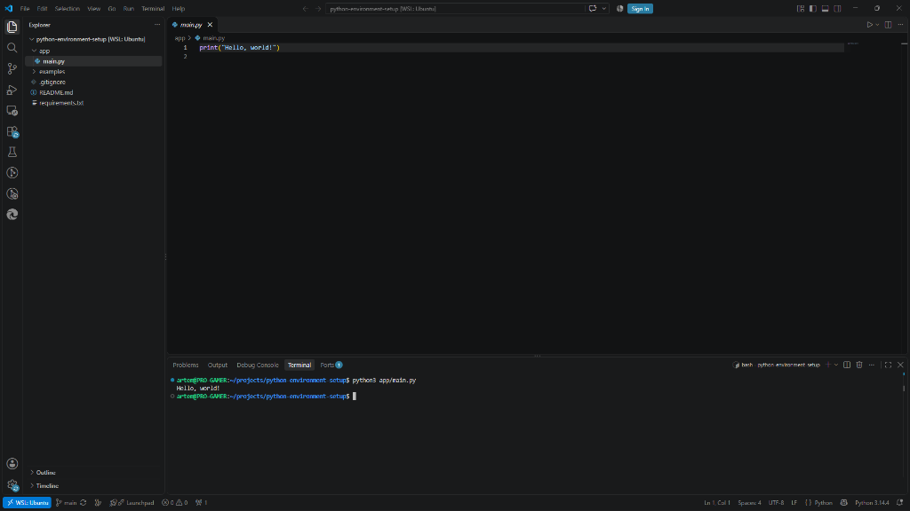

# Настройка рабочей среды для разработки на Python

Репозиторий содержит конфигурацию рабочей среды на базе WSL 2 (Ubuntu), Visual Studio Code и Git.

## Выполненные требования

- Установлена подсистема WSL 2 с дистрибутивом Ubuntu.
- Установлены интерпретатор Python 3.14 и пакетный менеджер pip 25.1.
- Развернут сервер VS Code в среде WSL через команду `code .`.
- Установлены расширения VS Code: Remote - WSL, Python, Pylance, GitLens.
- Настроен Git: указаны имя пользователя и адрес электронной почты.
- Создан публичный репозиторий на GitHub.
- Репозиторий склонирован в каталог `~/projects/python-environment-setup` внутри WSL.
- Создана структура каталогов `app/` и `examples/`.
- Добавлены файлы `.gitignore`, `requirements.txt` и `README.md`.
- Создан модуль `app/main.py` с выводом строки `Hello, world!`.
- Работа скрипта проверена запуском команды `python3 app/main.py`.
- Снимок экрана VS Code с результатом работы сохранен в каталог `examples/`.

## Структура проекта

```text
python-environment-setup/
├── app/
│   └── main.py
├── examples/
│   └── vscode_screenshot.png
├── .gitignore
├── README.md
└── requirements.txt
```

## Запуск программы

Для запуска программы откройте терминал WSL и выполните команду:

```bash
python3 app/main.py
```

Результат выполнения:

```text
Hello, world!
```

## Результат работы в VS Code


